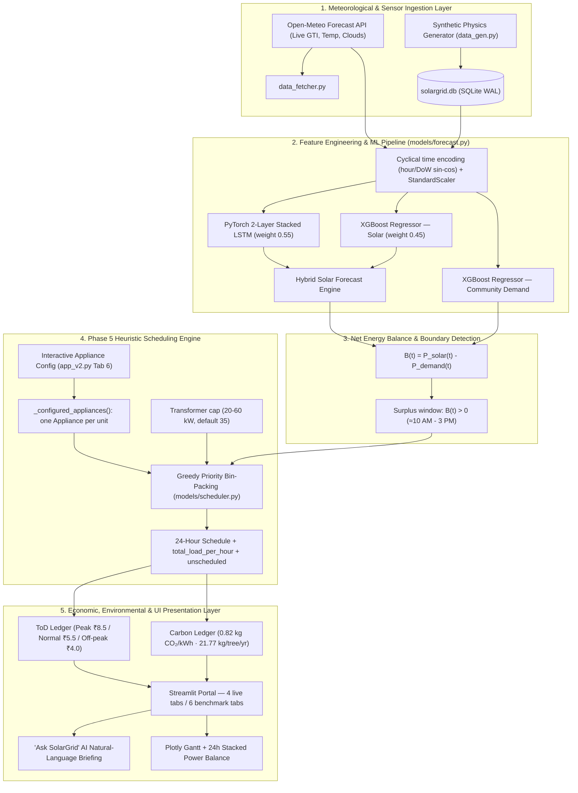

# DETAILED PROJECT REPORT (DPR)
## SolarGrid: AI-Enabled Solar Generation Forecasting, Real Meteorological Ingestion & Smart Community Load Scheduling

---

**Project Title:** SolarGrid — Smart Community Microgrid Optimization Engine
**Academic Level:** Bachelor of Engineering / Technology (CSE Final Seminar & Capstone)
**Institution:** Department of Computer Science & Engineering, Model Institute of Engineering and Technology (Autonomous), Jammu, India
**Candidate Name:** Suryansh Gupta
**University Roll No:** 2023a1r116
**Document Version:** 2.0 (Phases 1–7 complete; adds interactive per-unit appliance controls, live-city dynamic tabs, and a 10-case test suite)
**Date of Submission:** November 2026

---

### Executive Summary

Under modern distributed renewable-energy paradigms, rooftop photovoltaic (PV) installations are expanding rapidly across residential communities and institutional campuses in India. Two engineering challenges degrade their return on investment (ROI) and destabilize local distribution transformers:

1. **Photovoltaic Generation Intermittency:** Solar energy is strictly diurnal and highly sensitive to ambient temperature, cloud transmittance and seasonal declination, peaking during midday (10:00 AM – 3:00 PM).
2. **Community Demand Mismatch ("The Duck Curve"):** Residential demand exhibits a pronounced dual-peak behaviour — a morning spike (7:00–9:30 AM) and an intense evening peak (6:30–10:30 PM) — leaving the midday solar peak unconsumed.

Without intelligent demand-side management (DSM), unconsumed solar surplus is curtailed or fed back to the utility at unattractive feed-in tariffs (≈₹2.50/kWh), while heavy appliances (EV charging fleets, borewell water pumps, HVAC pre-cooling) draw energy during expensive peak periods (up to ₹8.50/kWh).

**SolarGrid** resolves this imbalance with an autonomous, end-to-end AI and optimization pipeline:

- **Real-Time Meteorological Ingestion:** Connects to the free, open **Open-Meteo Forecast API** to ingest one full local calendar day (00:00–23:00) of hourly Global Tilted Irradiance (GTI), Direct Normal Irradiance (DNI), cloud cover and ambient temperature for any coordinates, with built-in presets for Jammu, Delhi, Mumbai, Bengaluru, Jaipur and Chennai.
- **Hybrid Machine-Learning Forecasting Engine:** Combines a 2-layer stacked **PyTorch LSTM** (ensemble weight 0.55) with an **XGBoost Regressor** (weight 0.45) to forecast 24-hour generation; community baseline demand is forecast by a dedicated XGBoost regressor.
- **Phase 5 Heuristic Load Scheduler:** A multi-constraint **Greedy Priority Bin-Packing** algorithm shifts high-wattage deferrable loads into solar-surplus windows while enforcing non-interruptible charging blocks, operating deadlines and a transformer capacity cap.
- **Interactive Per-Unit Appliance Configuration (new):** Operators choose the **number of units** of each appliance, each unit's **kW rating** and **run-duration**, and the **transformer limit (20–60 kW)**. Each unit becomes an independent scheduling instance (e.g. `EV Charger #1`, `EV Charger #2`) so loads interleave across surplus hours. Every chart, ₹ saving and CO₂ figure recomputes instantly.
- **Economic & Environmental Ledgers:** Computes Time-of-Day (ToD) bill reductions in Indian Rupees and decarbonization using CEA grid emission factors (0.82 kg CO₂/kWh) and mature-tree sequestration equivalents (21.77 kg CO₂/tree/year).
- **Production Dashboard & "Ask SolarGrid" AI Briefing:** An interactive Streamlit dashboard with **four weather-driven tabs in Live City mode** and **six tabs in Historical Benchmark mode** (the two static dataset/model tabs are hidden in live mode), Plotly Gantt timelines, a 24-hour stacked power-balance chart, and a natural-language narrative summary for non-technical facility managers.

---

### Table of Contents

1. [Project Background, Problem Statement & Motivation](#1-project-background-problem-statement--motivation)
2. [Complete System Architecture & High-Level Data Flow](#2-complete-system-architecture--high-level-data-flow)
3. [Phase 1 & 2: Meteorological Modeling & Database Architecture](#3-phase-1--2-meteorological-modeling--database-architecture)
4. [Real Data Integration Layer (Zero Hardware Architecture)](#4-real-data-integration-layer-zero-hardware-architecture)
5. [Phase 3 & 4: Machine Learning & Deep Learning Forecasting Engine](#5-phase-3--4-machine-learning--deep-learning-forecasting-engine)
6. [Phase 5: Heuristic Load Scheduler & Interactive Appliance Configuration](#6-phase-5-heuristic-load-scheduler--interactive-appliance-configuration)
7. [Phase 6: Optimization Dashboard, Economic & Carbon Accounting](#7-phase-6-optimization-dashboard-economic--carbon-accounting)
8. [Phase 7: Validation, Testing Suite & Deployment](#8-phase-7-validation-testing-suite--deployment)
9. [Codebase Walkthrough & Developer Onboarding Guide](#9-codebase-walkthrough--developer-onboarding-guide)
10. [Viva Voce, Technical Evaluation & Defense Q&A](#10-viva-voce-technical-evaluation--defense-qa)
11. [Conclusion, Limitations & Future Research Roadmap](#11-conclusion-limitations--future-research-roadmap)
12. [References & Academic Citations](#12-references--academic-citations)

---

### 1. Project Background, Problem Statement & Motivation

#### 1.1 The Renewable Energy Paradox
In community microgrids with rooftop PV (residential societies, campuses, industrial parks), generation depends on extraterrestrial solar geometry and atmospheric transmittance:
- **Maximum solar production:** concentrated between 10:00 AM and 3:00 PM (≈1000 W/m² peak clear-sky irradiance).
- **Human behavioural load:** residents occupy homes predominantly before 9:00 AM and after 6:00 PM. During midday, homes are largely unoccupied, so base demand drops to standby levels (refrigeration, networking, idling electronics).

This misalignment creates the classic **"Duck Curve"**:
```
Power (kW)
   ^
   |        Morning Peak (7-9 AM)                     Evening Peak (6-10 PM)
   |             /\                                          /\
   |            /  \       Midday Solar Surplus             /  \
   |           /    \      +--------------------+          /    \
   |   Base   /      \     | Solar: 25-50 kW    |         /      \
   |  Demand /        \....| Demand: 10-15 kW   |......../        \
   |  ------+              +--------------------+                  +-----
   +--------------------------------------------------------------------> Hour of Day
     00:00      07:00              12:00               19:00       23:00
```

#### 1.2 The Economic & Environmental Penalty
Indian state distribution companies (DISCOMs) implement Time-of-Day (ToD) tariffs. SolarGrid models the following India-inspired bands (see `models/scheduler.py::_tariff_for_hour`):
- **Peak (18:00–21:00):** ₹8.50/kWh.
- **Normal (06:00–17:00 and 22:00):** ₹5.50/kWh.
- **Off-peak night (00:00–05:00 and 23:00):** ₹4.00/kWh.
- **Net-metering solar export credit:** ≈₹2.50/kWh (used only as narrative context).

When community appliances run uncoordinated in morning/evening peaks:
1. The society buys expensive grid electricity at ₹8.50/kWh.
2. Midday solar is exported for a meagre ₹2.50/kWh credit, losing ≈₹6.00 per unit.
3. Coal-fired thermal plants ramp spinning reserves for the evening spike, emitting ≈0.82 kg CO₂/kWh.

#### 1.3 Project Objective
1. **Predict:** forecast solar generation and baseline community load 24 hours ahead.
2. **Identify:** quantify the hourly net energy balance `B(t) = P_solar(t) − P_demand(t)`.
3. **Optimize:** shift deferrable community loads into positive-surplus hours (`B(t) > 0`) using priority bin-packing, without exceeding transformer safety thresholds.
4. **Quantify:** measure financial savings (₹) and environmental reduction (kg CO₂, equivalent trees).
5. **Empower (new):** let operators model their own appliance fleet interactively — unit counts, kW ratings, durations and transformer cap — and see the impact immediately.

---

### 2. Complete System Architecture & High-Level Data Flow

SolarGrid is a modular, 5-tier architecture connecting external meteorological providers, local relational persistence, ML inference, scheduling, and an interactive presentation interface.



**Shared-configuration invariant:** `_appliance_settings()` reads widget values from `st.session_state`, and `_configured_appliances()` expands them into a list of `Appliance` instances. The **same** list and the **same** `peak_cap_kw` are passed to both the Carbon & Savings tab and the Smart Scheduler tab, guaranteeing the two tabs always agree.

---

### 3. Phase 1 & 2: Meteorological Modeling & Database Architecture

#### 3.1 Physics Modeling for Clear-Sky Solar Irradiance
For offline synthetic benchmarking (and as a fallback when models or network are unavailable), `data_gen.py` implements empirical astronomical solar-geometry equations:

1. **Clear-sky irradiance** follows a diurnal half-sine between sunrise (t≈6) and sunset (t≈18):
   `I_cs(t) = max(0, 1000 · sin(π · (t − 6) / 12))  [W/m²]`
2. **Atmospheric attenuation (Beer-Lambert approximation):** cloud cover `C ∈ [0,100]` reduces incoming radiation via a transmittance factor, with small Gaussian noise added.
3. **Photovoltaic power output** accounts for rated capacity (`P_rated = 50 kW`), cell-temperature derating (−0.4%/°C above the 25°C standard test condition) and inverter/system efficiency (≈0.95):
   `P_solar(t) = P_rated · (I_actual(t)/1000) · [1 − 0.004·(T_ambient − 25)] · η_inv`

The generator uses a fixed random seed (42) and produces **30 days × 24 hours = 720 records** starting 2024-01-01.

#### 3.2 Dual-Peak Community Load Model
Baseline demand models residential activity as a standby base plus two Gaussian behavioural lobes:
`P_demand(t) = P_base + A₁·exp(−(t−μ₁)²/2σ₁²) + A₂·exp(−(t−μ₂)²/2σ₂²) + noise`
- **Morning peak** (μ₁≈8.0, σ₁≈1.5): water heaters, kitchen appliances, elevators, pump starts.
- **Evening peak** (μ₂≈19.5, σ₂≈1.8): air conditioning, lighting, entertainment, cooking.
- **Midday valley (11:00–16:00):** demand falls to ≈10–14 kW exactly when solar surges to ≈35–48 kW.
- Community peak demand scale ≈45 kW (representative ~20-home community).

#### 3.3 Relational SQLite Database Architecture (`database/db_manager.py`)
Persistence uses an embedded SQLite database (`solargrid.db`) in **Write-Ahead Logging (WAL)** mode for non-blocking concurrent reads during Streamlit re-renders. The DB path is resolved relative to the module so the app works from any working directory.

```sql
CREATE TABLE IF NOT EXISTS historical_energy (
    id                            INTEGER PRIMARY KEY AUTOINCREMENT,
    timestamp                     TEXT    NOT NULL UNIQUE,
    temperature_c                 REAL    NOT NULL,  -- Ambient temperature (°C)
    cloud_cover_pct               REAL    NOT NULL,  -- Cloudiness (0-100%)
    solar_irradiance_wm2          REAL    NOT NULL,  -- Global Tilted Irradiance (W/m²)
    historical_solar_gen_kw       REAL    NOT NULL,  -- Photovoltaic power generated (kW)
    historical_baseline_demand_kw REAL    NOT NULL   -- Community load consumed (kW)
);

CREATE TABLE IF NOT EXISTS forecasts (
    id                  INTEGER PRIMARY KEY AUTOINCREMENT,
    created_at          TEXT    NOT NULL,
    forecast_hour       INTEGER NOT NULL,            -- Hour index (0-23)
    predicted_solar_kw  REAL    NOT NULL,            -- Hybrid ensemble prediction
    predicted_demand_kw REAL    NOT NULL             -- XGBoost demand prediction
);
```

---

### 4. Real Data Integration Layer (Zero Hardware Architecture)

#### 4.1 Resolving the Academic Guide Pushback
A frequent criticism from evaluators is reliance on purely synthetic data. Deploying physical IoT pyranometers, smart meters and RS485 modems across a community microgrid is capital-intensive and fragile for classroom demonstrations. **SolarGrid solves this without hardware** by integrating real-world meteorological REST APIs.

#### 4.2 Open-Meteo Forecast API Integration (`data_fetcher.py`)
`fetch_live_forecast(lat, lon, city_name, target_date)` requests one full local calendar day:
```
https://api.open-meteo.com/v1/forecast
  ?latitude={lat}&longitude={lon}
  &hourly=temperature_2m,cloud_cover,direct_normal_irradiance,global_tilted_irradiance
  &start_date={day}&end_date={day}&timezone=auto
```
- **No API key required;** no authentication, rate-limit keys or credit card.
- **Parameters ingested:** `global_tilted_irradiance` (GTI → `solar_irradiance_wm2`), `direct_normal_irradiance` (DNI), `cloud_cover` (kept as %), `temperature_2m` (ambient dry-bulb).
- **Local time:** `timezone=auto` returns timestamps in the city's local timezone; `start_date=end_date` guarantees a complete 00:00–23:00 day (24 rows).
- **Robustness:** stdlib `urllib` (no `requests` dependency), custom User-Agent, 15 s timeout, 3 retries with backoff; occasional nulls are interpolated (not dropped) so the row index stays aligned to the hour of day. Incomplete days return `None`.
- **Feature schema:** cyclical encodings (`hour_sin/cos`, `dow_sin/cos`, `day_of_year`) are appended so the returned DataFrame matches the inference schema exactly.

A second function, `fetch_historical_archive(...)`, uses the Open-Meteo **Archive** API for real historical weather; it is available for dataset regeneration but is not used by the live dashboard mode.

#### 4.3 Built-in Indian City Presets
```python
CITY_PRESETS = {
    "Jammu":     {"lat": 32.7266, "lon": 74.8570},
    "Delhi":     {"lat": 28.6139, "lon": 77.2090},
    "Mumbai":    {"lat": 19.0760, "lon": 72.8777},
    "Bengaluru": {"lat": 12.9716, "lon": 77.5946},
    "Jaipur":    {"lat": 26.9124, "lon": 75.7873},
    "Chennai":   {"lat": 13.0827, "lon": 80.2707},
}
```

#### 4.4 Live "What-If" Forecast Mode & Graceful Fallback
Selecting **"🌐 Live City Forecast"** triggers `load_live_forecast(...)`, which calls the cached `_live_forecast_cached(...)`. The cache **raises on failure** so Streamlit never caches a failed fetch. On any exception the app falls back to the benchmark synthetic forecast and renders a warning banner; on success it renders a live banner naming the city, date and fetch time. The live weather vectors are normalized and passed through the saved PyTorch and XGBoost weights, producing predictions grounded in **today's actual atmospheric conditions**.

---

### 5. Phase 3 & 4: Machine Learning & Deep Learning Forecasting Engine

SolarGrid deploys a **hybrid ensemble** combining a recurrent deep network with gradient-boosted trees.

```
Weather vector: [Temp, Cloud%, GTI, sin(Hour), cos(Hour), sin(DoW), cos(DoW), DayOfYear]
                                |
             +------------------+------------------+
             |                                     |
             v                                     v
   +--------------------+               +--------------------+
   |    PyTorch LSTM    |               |  XGBoost Regressor |
   |  2 Stacked Layers  |               |    300 Estimators  |
   |   Hidden Size: 64  |               |    Max Depth: 6    |
   +--------------------+               +--------------------+
             |                                     |
      Solar Pred (LSTM)                     Solar Pred (XGB)
             |                                     |
             +-------------> [ 0.55·LSTM + 0.45·XGB ] ----> Final Solar Forecast (kW, 24 h)

      Demand Pred (XGB) ----------------------------------> Community Demand (kW, 24 h)
```

#### 5.1 Temporal Feature Engineering (`models/train_models.py`)
To avoid the artificial discontinuity between hour 23 and hour 0, circular trigonometric transforms are applied:
`Hour_sin = sin(2π·t/24)`, `Hour_cos = cos(2π·t/24)`, `DoW_sin = sin(2π·d/7)`, `DoW_cos = cos(2π·d/7)`.
Continuous features (`temperature_c`, `cloud_cover_pct`, `solar_irradiance_wm2`) are normalized to zero mean and unit variance with scikit-learn `StandardScaler`. Separate scalers are fitted for the solar and demand targets. The eight feature columns are persisted to `models/saved/feature_cols.json`.

#### 5.2 PyTorch Two-Layer Stacked LSTM (`models/lstm_model.py`)
- **Input:** 8 features; **lookback window** `seq_len = 24` preceding hourly steps.
- **Recurrent stack:** 2 LSTM layers, 64 hidden units each, `batch_first=True`, dropout 0.2 between layers.
- **Regression head:** the **last** hidden state is taken (many-to-one), passed through dropout, then a single `Linear(64 → 1)` layer. *(The head is a single linear projection, not a multi-layer MLP.)*
- **Optimization:** Adam (lr = 1e-3), **Huber loss** (robust to outliers vs plain MSE), gradient-norm clipping (max_norm = 1.0), 30 epochs, batch size 32, no shuffle (temporal order preserved). The best-validation-loss weights are checkpointed and restored before saving.
- **Inference warm-up:** for a 24-hour look-ahead the first feature row is replicated `seq_len` times as warm-up history (`models/forecast.py`).

#### 5.3 Extreme Gradient Boosting (XGBoost Regressors)
Tree ensembles capture abrupt non-linear boundaries (e.g. cloud cover crossing an optical threshold) and temperature-driven cooling load:
- **Hyperparameters:** `n_estimators = 300`, `max_depth = 6`, `learning_rate = 0.05`, `subsample = 0.8`, `colsample_bytree = 0.8`, `tree_method = "hist"`, `early_stopping_rounds = 20`, `eval_metric = "mae"`, `random_state = 42`.
- **Solar model** (`xgb_solar.joblib` / `.json`) and **Demand model** (`xgb_demand.joblib` / `.json`) are saved in both joblib and native JSON formats for portable loading.

#### 5.4 Ensemble Blend & Empirical Validation
At inference (`models/forecast.py`): `predicted_solar = 0.55·LSTM + 0.45·XGBoost`; `predicted_demand = XGBoost_demand`. Outputs are clipped to physical bounds (solar 0–55 kW, demand 3–55 kW). If model artefacts are missing, a physics-only fallback keeps the UI functional.

Models are evaluated on a **chronological 80/20 holdout** (final 20% = **144 unseen hours**). The training script persists **MAE / RMSE / MAPE** to `models/saved/metrics.json`:

| Target Variable | MAE (kW) | RMSE (kW) | MAPE (%) |
| :--- | :---: | :---: | :---: |
| Solar Generation (XGBoost holdout) | 1.338 | 3.133 | 9.14 |
| Community Demand (XGBoost holdout) | 0.913 | 2.214 | 6.41 |

> **Academic integrity note:** `metrics.json` currently stores MAE/RMSE/MAPE only. The training script does **not** compute an R² score or a formal standalone-LSTM vs standalone-XGBoost ablation table. Earlier drafts of this report quoted such figures; they have been removed because they are not produced by the current code. A rigorous ablation and R² study is listed under Future Work (§11.3). The ensemble *blend weights* (0.55/0.45) and the qualitative rationale (LSTM for temporal smoothness, XGBoost for sharp non-linear thresholds) are implemented and verified.

---

### 6. Phase 5: Heuristic Load Scheduler & Interactive Appliance Configuration

#### 6.1 The Scheduling Challenge & Mathematical Formulation
The scheduler receives forecasted solar `P_solar(t)` and baseline demand `P_demand(t)` and computes:
`B(t) = P_solar(t) − P_demand(t),  t ∈ {0,…,23}`
- **Surplus window:** hours where `B(t) > 0` (typically 10:00–15:00).
- **Deficit window:** hours where `B(t) < 0` (grid draw required).

#### 6.2 Appliance Constraint Matrix (defaults)
Each appliance has operational physics encoded in the `Appliance` dataclass (`models/scheduler.py`):

| Appliance | Rated Power | Duration | Priority | Interruptible? | Earliest Start | Deadline | Context |
| :--- | :---: | :---: | :---: | :---: | :---: | :---: | :--- |
| **EV Charging Fleet** | 11.0 kW | 3 h | 1 (highest) | **No** (continuous) | 06:00 | 17:00 | Community EV fast charging; BMS needs uninterrupted power; finish before residents return. |
| **Community Water Pump** | 5.0 kW | 2 h | 2 | **Yes** (splittable) | 06:00 | 18:00 | Borewell/reservoir lifting; can run in split sessions before evening supply. |
| **HVAC Pre-cooling** | 3.5 kW | 2 h | 3 | **Yes** (splittable) | 09:00 | 16:00 | Pre-cool common areas during peak insolation to reduce evening AC spikes. |

#### 6.3 Interactive Per-Unit Configuration (Option B — individual instances)
The Smart Scheduler tab exposes a bordered card per category. The UI specification lives in `app_v2.py::_APPLIANCE_UI` and is zipped with `DEFAULT_APPLIANCES` so the model and UI stay in sync:

| Control | EV Charger 🔌 | Water Pump 💧 | HVAC Zone ❄️ |
| :--- | :---: | :---: | :---: |
| Number of units | 1–5 | 1–4 | 1–3 |
| Power per unit (kW), step 0.5 | 3.0–22.0 | 1.0–15.0 | 1.0–10.0 |
| Run duration (h) | 1–6 | 1–4 | 1–4 |

A global **🛡️ Distribution Transformer Limit** slider sets `peak_cap_kw` (**20–60 kW**, default 35, step 1).

**Expansion logic** (`_configured_appliances`): for each enabled category, one `Appliance` is created **per unit** using `dataclasses.replace(base, name=…, power_kw=cfg_kw, duration_hours=cfg_dur)`. When count > 1 the instances are named `EV Charger #1`, `EV Charger #2`, …; when count = 1 the base name is kept. `DEFAULT_APPLIANCES` is never mutated. Because each unit is scheduled independently, the scheduler can **interleave** units into different surplus hours rather than forcing one oversized block.

**Shared state:** `_appliance_settings()` reads values from `st.session_state` (with defaults on first load). This is necessary because the Carbon & Savings tab renders *before* the Scheduler tab creates its widgets. Both tabs consume the identical configured list and cap.

#### 6.4 The Greedy Priority Bin-Packing Algorithm (`models/scheduler.py`)
```text
Input: solar_kw[0..23], demand_kw[0..23], appliances, peak_cap_kw = 35.0
Output: ScheduleResult(schedule, surplus_used_kwh, grid_fallback_kwh,
                       total_load_per_hour, unscheduled)

1. surplus[t]    = solar_kw[t] - demand_kw[t]
2. total_load[t] = demand_kw[t]
3. Sort appliances by priority ascending (1 = highest)

4. FOR EACH appliance:
     window = [earliest_start, deadline_hour)        # must FINISH by deadline
     IF window length < duration: mark unscheduled; continue

     IF NOT interruptible:
        # Pass 1: best CONTINUOUS block fully covered by surplus
        FOR start in [earliest_start .. deadline_hour - duration]:
            block = [start .. start+duration-1]
            IF any(total_load[t] + power > peak_cap_kw): skip
            IF all(surplus[t] >= power): track block maximising Σ surplus
        # Pass 2: if none, cheapest-tariff block that fits the cap
        IF no block found: pick block minimising Σ tariff(t) subject to cap
        IF still none: mark unscheduled; continue
        Commit block; update surplus_used / grid_fallback / surplus / total_load

     ELSE (interruptible):
        candidates = [t in window IF total_load[t] + power <= peak_cap_kw]
        sort candidates by surplus descending (tie-break by hour)
        IF len(candidates) < duration: mark unscheduled; continue
        Take top `duration` hours; commit; update running arrays

5. Return ScheduleResult (rounded surplus/grid kWh)
```

#### 6.5 Why Heuristic Bin-Packing vs. MILP Solvers?
Heavy external MILP solvers (CBC, GLPK, Gurobi via PuLP) require native compiled binaries that frequently fail to install across Windows/macOS-ARM/Linux. The heuristic solves in **milliseconds**, guarantees zero installation failure, and is fully transparent to explain to an evaluation committee. (A formal optimality-gap benchmark against a MILP optimum is future work, not a claimed result.)

#### 6.6 Time-of-Day Costing Honours Custom Instances
`compute_tod_savings(schedule_result, solar_kw, demand_kw, appliances=None)` builds a `power_lookup` from the **passed appliance list**, so renamed per-unit instances and custom kW ratings are costed correctly. *(Passing the configured list fixed a real bug: looking up names from `DEFAULT_APPLIANCES` returned 0 for renamed units and zeroed all savings.)*
- **Baseline (worst case):** every scheduled appliance's energy `P_k · D_k` priced at the peak tariff ₹8.50.
- **Optimized:** `Σ_t P_k · tariff(t)` over the actually-scheduled hours.
- **Savings:** `baseline − optimized`, plus percentage reduction.

---

### 7. Phase 6: Optimization Dashboard, Economic & Carbon Accounting

#### 7.1 "Ask SolarGrid" AI Narrative Briefing Box
At the top of the Carbon & Savings tab, a deterministic zero-latency template engine (`generate_ai_summary`) renders an executive briefing, e.g.:
> ☀️ **Today's Conditions:** Clear. Peak solar window: **11:00–14:00**.
> 🤖 **AI Actions Taken:** Shifted **N appliance(s)** into the surplus window, consuming **X kWh** of otherwise-wasted solar.
> 💰 **Financial Impact:** Saved **₹…** vs unmanaged peak tariff today.
> 🌱 **Environmental Impact:** Avoided **… kg CO₂** — equivalent to planting **… mature trees** today.

The weather condition is inferred from a cloud-cover proxy derived from the solar curve; the appliance count, surplus kWh, ₹ savings and CO₂ all come from the shared scheduler result.

#### 7.2 Time-of-Day (ToD) Financial Ledger
Tariff bands (see §1.2): Peak 18–21 ₹8.50; Normal 06–17 & 22 ₹5.50; Off-peak 00–05 & 23 ₹4.00. The dashboard shows baseline (unmanaged) cost, optimized cost, net saving and % reduction in a "Tariff Cost Breakdown" expander, plus daily/monthly (×30)/annual (×365) savings KPI cards.

#### 7.3 Carbon Emissions & "Trees Saved"
`compute_carbon_savings(surplus_used_kwh)` uses:
- **Grid carbon intensity:** 0.82 kg CO₂/kWh (CEA India baseline).
- **Tree sequestration:** 21.77 kg CO₂ per mature tree per year.
- Returns `co2_saved_kg`, `trees_equivalent`, `annual_co2_kg` (×365) and `annual_trees` (×365). The UI displays four carbon KPI cards (CO₂ today, tree-equivalents, annual tonnes CO₂, annual trees).

#### 7.4 Interactive UI Structure (`app_v2.py`) — Dynamic-First Tabs
The four weather-driven tabs always come first; the two static tabs appear only in Historical Benchmark mode:

| Order | Tab | Live mode | Benchmark mode |
| :---: | :--- | :---: | :---: |
| 1 | 📈 24-Hour Forecast | ✓ | ✓ |
| 2 | ⚖ Surplus Analysis | ✓ | ✓ |
| 3 | 🌿 Carbon & Savings | ✓ | ✓ |
| 4 | ⚙️ Smart Scheduler | ✓ | ✓ |
| 5 | 📊 Data Exploration | — (hidden) | ✓ |
| 6 | 🧠 Model Architecture & Evaluation | — (hidden) | ✓ |

The static tabs are hidden in live mode because they describe the *training* dataset and stored model metrics, which are not loaded when running on live weather (`hist_df` and `metrics` are empty in live mode).

**Smart Scheduler tab outputs:** appliance configuration cards + transformer slider; a **transformer safety badge** (green "Transformer Safe" with peak load, or amber "Overload Warning" listing the offending hours and noting when base demand alone exceeds the cap); three metrics (solar surplus used, grid fallback, unscheduled / all-scheduled count); a **Plotly Gantt chart** (green = solar-powered, orange = grid draw, red = unmanaged baseline); a **24-hour stacked power-balance** area chart; and an hourly schedule-detail table.

---

### 8. Phase 7: Validation, Testing Suite & Deployment

#### 8.1 Automated Test Suite (`tests/test_scheduler.py`) — 10 cases
| # | Test | What it verifies |
| :---: | :--- | :--- |
| 1 | `test_scheduler_returns_result` | Dataclass output integrity and dictionary keys. |
| 2 | `test_transformer_cap_not_exceeded` | Total load never breaches the cap (1 kW tolerance). |
| 3 | `test_zero_solar_all_grid` | Zero-solar day → surplus used = 0, no crash. |
| 4 | `test_carbon_savings` | Exact CEA 0.82 kg/kWh conversion (10 kWh → 8.2 kg). |
| 5 | `test_tod_savings_positive` | Baseline cost > 0 and savings ≥ 0. |
| 6 | `test_custom_power_scales_energy` | Doubling kW doubles scheduled energy. |
| 7 | `test_tod_savings_uses_instance_names` | Renamed per-unit instances are costed (baseline = 2·33·8.50). |
| 8 | `test_instances_interleave` | Two units land in different surplus hours (22 kWh used). |
| 9 | `test_lower_cap_blocks_oversized_load` | A lowered cap blocks an oversized load (marked unscheduled). |
| 10 | `test_empty_appliance_list` | Empty list is safe end-to-end (zero cost/savings). |

#### 8.2 Execution Results
```
$ python -m pytest tests/test_scheduler.py -q
..........                                                               [100%]
10 passed in 0.10s
```
Tests 6–10 were added alongside the interactive per-unit feature to lock in custom-kW scaling, instance naming, interleaving, cap enforcement and empty-list safety.

#### 8.3 Deployment
`streamlit run app.py` launches the production dashboard. `requirements.txt` pins a CPU-only PyTorch wheel for fast, GPU-free cloud boot. The app degrades gracefully: missing models → physics fallback; failed live fetch → benchmark fallback with a warning banner.

---

### 9. Codebase Walkthrough & Developer Onboarding Guide

```
suraj_nanga/
├── app.py                      # Entry point: imports organized_main() from app_v2 (fallback: app_interim)
├── app_v2.py                   # Production dashboard (~1,547 lines; 4 live / 6 benchmark tabs)
├── app_interim.py              # Preserved Phase 1–4 interim dashboard (fallback only)
├── data_fetcher.py             # Open-Meteo REST client (live forecast + archive + city presets)
├── data_gen.py                 # Synthetic solar geometry & dual-peak demand generator (720 rows)
├── solargrid.db                # SQLite database (WAL), 720 hourly historical records
├── requirements.txt            # Dependencies (CPU torch wheel)
├── README.md                   # Newcomer onboarding & quickstart
├── DPR.md                      # This Detailed Project Report
├── PROJECT_MILESTONE_REPORT.txt# Formal seminar technical report
├── database/
│   ├── __init__.py
│   └── db_manager.py           # SQLite connection, WAL pragma & schema definitions
├── models/
│   ├── __init__.py
│   ├── forecast.py             # Inference: 0.55/0.45 ensemble, live-weather support, fallback
│   ├── scheduler.py            # Greedy priority bin-packing + ToD + carbon accounting
│   ├── lstm_model.py           # SolarLSTM (2×64, dropout 0.2, Linear(64→1) head)
│   ├── train_models.py         # Offline training & holdout evaluation (writes metrics.json)
│   └── saved/                  # lstm_solar.pt, xgb_*.json/.joblib, scalers, metrics.json, feature_cols.json
└── tests/
    ├── __init__.py
    └── test_scheduler.py       # 10-case pytest suite
```

#### How Data Flows at Runtime
1. `app.py` imports and calls `organized_main()` from `app_v2.py`.
2. The sidebar selects the data mode:
   - **Live City Forecast:** `data_fetcher.fetch_live_forecast()` queries Open-Meteo for the chosen city/day → 24-row weather DataFrame → `models/forecast.get_24hr_forecast(live_weather_df=…)`.
   - **Historical Benchmark:** `get_24hr_forecast(target_date=…)` builds a reproducible synthetic physics day.
3. `forecast.py` scales features (`scaler_features.pkl`), runs `lstm_solar.pt` and `xgb_solar.json`, blends 0.55/0.45 for solar, and uses `xgb_demand.json` for demand.
4. `_appliance_settings()` + `_configured_appliances()` build the per-unit appliance list and transformer cap from session state.
5. `scheduler.run_scheduler()` produces the timetable; `compute_tod_savings()` and `compute_carbon_savings()` produce the economic and ESG ledgers.
6. The same results feed the Gantt chart, power-balance chart, safety badge, KPI cards and "Ask SolarGrid" box across the Carbon & Savings and Smart Scheduler tabs.

#### Customization
- **New city:** add to `CITY_PRESETS` in `data_fetcher.py`.
- **New appliance category:** add an `Appliance` to `DEFAULT_APPLIANCES` **and** a matching `_APPLIANCE_UI` entry in `app_v2.py` (same order). The helpers zip the two lists.
- **Retrain:** `python models/train_models.py`.

---

### 10. Viva Voce, Technical Evaluation & Defense Q&A

**Q1: Why an ensemble of LSTM and XGBoost instead of just an LSTM?**
Solar has smooth diurnal progression (planetary rotation) and sharp non-linear drops (sudden cloud shading). LSTMs keep sequential temporal context but over-smooth step changes; XGBoost handles non-linear threshold splits but has no sequential memory. The blend `0.55·LSTM + 0.45·XGB` combines both. Holdout MAE/RMSE/MAPE are persisted in `metrics.json`; a formal ablation/R² study is future work.

**Q2: How do you justify "Real Data" without physical IoT sensors?**
The Open-Meteo Forecast API streams live GTI, DNI, cloud cover and temperature derived from satellite pyranometry and NWP models. "Live City Forecast" runs the models on the actual conditions for the chosen city and day, fetched as a full local calendar day with `timezone=auto`.

**Q3: How does the scheduler handle non-interruptible appliances like EV charging?**
It enforces a continuous contiguous block. For a 3-hour charger it scans windows `[t, t+1, t+2]` before the 17:00 deadline, preferring the block fully covered by surplus that maximises capture, falling back to the cheapest-tariff block that fits the cap, and allocating atomically.

**Q4: What happens on a severe monsoon day with zero surplus?**
`B(t) ≤ 0` everywhere. Rather than failing or running at expensive peak hours, non-interruptible loads fall back to the cheapest-tariff block (night off-peak ₹4.00/kWh). `test_zero_solar_all_grid` verifies surplus used = 0.

**Q5: What is the significance of the 0.82 constant?**
It is the CEA (Government of India) weighted-average grid emission factor (kg CO₂/kWh), reflecting India's coal-heavy generation mix.

**Q6: What does setting "number of units = 2" actually do?**
It creates two independent `Appliance` instances (`EV Charger #1`, `#2`) via `dataclasses.replace`, each scheduled separately so they interleave into different surplus hours. `compute_tod_savings` receives the same instance list so renamed units are costed correctly — fixing a bug that previously zeroed savings.

**Q7: Why are only four tabs shown in Live City mode?**
The Data Exploration and Model Architecture tabs describe the *training* dataset and stored metrics, which are not loaded in live mode. Hiding them avoids showing stale/empty static content; the four weather-driven tabs remain fully dynamic.

**Q8: How do the Carbon and Scheduler tabs stay consistent?**
Both consume the same `_configured_appliances()` list and `peak_cap_kw`, read from `st.session_state`. Configuration is shared, so the tabs cannot disagree even though Carbon renders first.

**Q9: How is the transformer protected, and what if base demand alone is too high?**
A hard cap (`peak_cap_kw`, 20–60 kW, default 35) on `base demand + scheduled load` per hour; offending slots are skipped. If base demand alone exceeds the cap, the safety badge explicitly says so — the scheduler cannot fix that, it can only avoid adding load.

---

### 11. Conclusion, Limitations & Future Research Roadmap

#### 11.1 Conclusion
SolarGrid demonstrates that AI forecasting combined with pragmatic heuristic scheduling can resolve the community solar intermittency problem. By shifting heavy loads into the midday surplus window — and letting operators model their own fleet interactively — community microgrids can materially reduce electricity bills and carbon intensity without expensive physical sensor hardware.

#### 11.2 Current Limitations
- **Battery Energy Storage (BESS):** the scheduler targets deferrable active loads (EVs, pumps, HVAC); dynamic state-of-charge modelling for battery banks is not yet included.
- **Phase balance:** assumes an aggregated community load; phase-imbalance optimization is left for future work.
- **Evaluation depth:** the training script persists MAE/RMSE/MAPE but does not yet compute R² or a formal ablation/optimality-gap study.
- **UI behaviour:** a pre-existing Streamlit quirk resets the active tab to the first tab after a widget-triggered rerun (settings are preserved; calculations are unaffected).

#### 11.3 Future Roadmap
1. **Rigorous model evaluation:** add R², a standalone-LSTM vs standalone-XGBoost vs ensemble ablation, and a MILP optimality-gap benchmark for the scheduler.
2. **Vehicle-to-Grid (V2G):** let parked EVs discharge back into the community during evening peak.
3. **Battery SoC scheduling:** co-optimize deferrable loads and chemical storage.
4. **Peer-to-Peer (P2P) energy trading:** smart-contract micro-transactions between prosumers and consumers.
5. **Physical IoT relay gateway:** MQTT brokers driving ESP32 smart relays for real circuit switching.

---

### 12. References & Academic Citations

1. Hochreiter, S., & Schmidhuber, J. (1997). "Long Short-Term Memory". *Neural Computation*, 9(8), 1735–1780.
2. Chen, T., & Guestrin, C. (2016). "XGBoost: A Scalable Tree Boosting System". *ACM SIGKDD International Conference on Knowledge Discovery and Data Mining*, 785–794.
3. Central Electricity Authority (CEA), Ministry of Power, Government of India. (2024). *CO₂ Baseline Database for the Indian Power Sector, User Guide Version 19.0*. New Delhi.
4. Masters, G. M. (2004). *Renewable and Efficient Electric Power Systems*. John Wiley & Sons, Hoboken, NJ.
5. Open-Meteo GmbH. (2024). *Open-Meteo Solar Radiation & Terrestrial Meteorological API Documentation*. https://open-meteo.com/
6. National Renewable Energy Laboratory (NREL). (2023). *National Solar Radiation Database (NSRDB) 1998–2022*. Golden, CO.
7. US Environmental Protection Agency (EPA). (2023). *Greenhouse Gases Equivalencies Calculator — Calculations and References*.