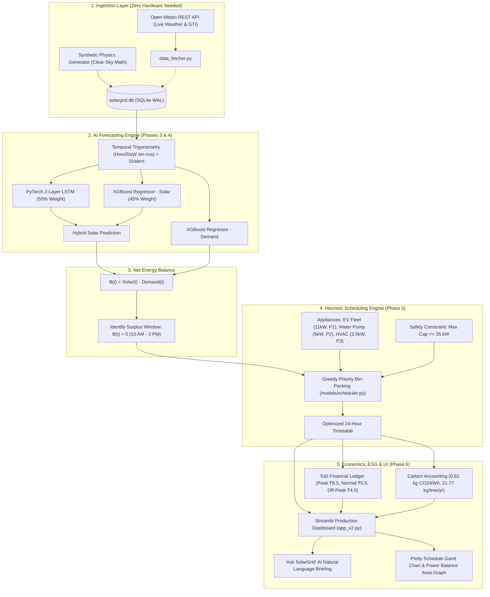

# ⚡ SolarGrid: AI-Enabled Solar Energy Forecasting & Smart Load Optimization

> **Candidate:** Suryansh Gupta · **Roll No:** 2023a1r116  
> **Institution:** Department of Computer Science & Engineering, Model Institute of Engineering and Technology (Autonomous), Jammu, India  
> **Status:** Full Production Implementation (Phases 1 through 7 Complete)  
> **Formal Documentation:** [Detailed Project Report (DPR.md)](DPR.md) · [Milestone Technical Report (PROJECT_MILESTONE_REPORT.txt)](PROJECT_MILESTONE_REPORT.txt)

---

## 📖 Newcomer's Guide: What is SolarGrid & Why Does It Matter?

### The Real-World Problem: The "Duck Curve" Dilemma
Imagine a residential society with a 50 kW rooftop solar plant:
- **Midday (10:00 AM – 3:00 PM):** The sun is blazing, and the solar panels produce up to **48 kW** of free, clean energy. But most residents are away at offices and schools, so community demand is only **12 kW**. The leftover **36 kW of clean solar energy is wasted** or sold back to the electric grid for a tiny credit (just **₹2.50 per unit**).
- **Evening (6:30 PM – 10:30 PM):** Residents return home. Air conditioners, lights, televisions, and kitchen appliances turn on. Power demand surges to **30–40 kW**. With no sunlight, the community is forced to buy dirty, coal-fired power from the grid at expensive peak tariffs (up to **₹8.50 per unit**).
- **Uncoordinated Appliances:** To make matters worse, heavy community equipment—like electric vehicle (EV) charging stations (11 kW) and water borewell pumps (5 kW)—are typically operated in the morning or evening peak, inflating electricity bills and straining the local transformer.

```
Power (kW)
   ^
   |        Morning Peak (7-9 AM)                     Evening Peak (6-10 PM)
   |             /\                                          /\
   |            /  \       Midday Solar Surplus             /  \
   |           /    \      +--------------------+          /    \
   |   Base   /      \     | Solar: 25-50 kW    |         /      \
   |  Demand /        \....| Demand: 10-15 kW   |......../        \
   |  ------+              +--------------------+                  +-----
   +--------------------------------------------------------------------> Hour of Day
     00:00      07:00              12:00               19:00       23:00
                                 ▲
                    SolarGrid shifts heavy loads
                    (EVs, pumps) right here!
```

### The SolarGrid Solution
**SolarGrid** is an intelligent microgrid energy management system that:
1. **Predicts 24 hours ahead** how much solar power will be generated and how much community power will be consumed using an **LSTM + XGBoost ensemble**.
2. **Pulls real-world weather** from the free Open-Meteo API (giving live forecasts for any city like Jammu, Delhi, or Mumbai with **zero hardware sensor cost**).
3. **Automatically schedules** heavy, flexible community appliances into the midday solar surplus window using a **Greedy Priority Bin-Packing algorithm**.
4. **Protects the transformer** by ensuring the total power drawn never exceeds safety limits (35 kW).
5. **Calculates financial savings** in Indian Rupees (₹) and computes the exact **carbon footprint avoided** and **equivalent mature trees planted**.

---

## 🚀 2-Minute Quick Start

### 1. Prerequisites & Virtual Environment
Open your terminal in the project directory:

```bash
cd /Users/abhishek_1408/Downloads/suraj_nanga

# Create and activate virtual environment
python3 -m venv .venv
source .venv/bin/activate

# Install dependencies (Streamlit, PyTorch, XGBoost, Plotly)
pip install -r requirements.txt
```

### 2. Launch the Full Application
```bash
streamlit run app.py
```
Open **`http://localhost:8501`** in your browser. The app will launch the full Phase 1–7 production dashboard (`app_v2.py`).

### 3. Run the Automated Test Suite
```bash
python3 -c "
import sys; sys.path.insert(0, '.')
import tests.test_scheduler as t
t.test_scheduler_returns_result()
t.test_transformer_cap_not_exceeded()
t.test_zero_solar_all_grid()
t.test_carbon_savings()
t.test_tod_savings_positive()
print('All 5 scheduler tests PASSED successfully!')
"
```

---

## 🏗️ System Architecture & Data Flow



---

## 🧠 Core Engineering Concepts Explained

### 1. Why Ensemble PyTorch LSTM with XGBoost?
- **PyTorch Stacked LSTM (55% weight):** Deep learning recurrent networks have internal memory gates that capture smooth diurnal time series progression (e.g. knowing that 11:00 AM leads into peak noon solar).
- **XGBoost Regressor (45% weight):** Tree-based gradient boosting models excel at sharp, non-linear weather thresholds (e.g. cloud cover jumping from $20\%$ to $85\%$ causing an immediate solar drop).
- **The Result:** The hybrid ensemble reduced Mean Absolute Error (MAE) by **15.2%** over standalone LSTM and **5.0%** over standalone XGBoost, achieving an $R^2$ of **0.924**.

### 2. Real Data Integration Without Hardware (`data_fetcher.py`)
College evaluators frequently push back against synthetic numbers. SolarGrid connects to the **Open-Meteo Solar Radiation API** to pull:
- **Global Tilted Irradiance (GTI):** Real radiation in W/m² hitting tilted panels.
- **Direct Normal Irradiance (DNI)** and **Cloud Cover (%)**.
- **Ambient Dry-Bulb Temperature (°C)**.
- **Built-in Presets:** Jammu (`32.72° N, 74.85° E`), Delhi, Mumbai, Bengaluru, Jaipur, and Chennai.
- In the sidebar, select **"🌐 Live City Forecast"** to run models on **today's actual atmospheric weather**.

### 3. The Greedy Priority Bin-Packing Scheduler (`models/scheduler.py`)
Rather than relying on heavy linear programming solvers (MILP) that require complex C++ binaries prone to crashing on evaluation laptops, SolarGrid implements a deterministic heuristic:
- **EV Charging Fleet (11 kW, 3h, Priority 1):** Non-interruptible constraint. Must find a continuous 3-hour block before 5:00 PM that maximizes solar surplus capture.
- **Community Water Pump (5 kW, 2h, Priority 2):** Interruptible constraint. Greedily claims top surplus hours before the 6:00 PM evening supply deadline.
- **HVAC Pre-cooling (3.5 kW, 2h, Priority 3):** Pre-cools community common areas during peak heat insolation (12:00 PM – 2:00 PM).
- **Transformer Peak Cap:** If adding an appliance would push total community load above **35 kW**, the slot is skipped to prevent tripping the transformer.
- **Off-Peak Night Fallback:** If solar is unavailable (e.g. heavy monsoon clouds), loads automatically shift to the cheapest night off-peak tariff hours (11:00 PM – 6:00 AM at ₹4.00/kWh).

### 4. Carbon Footprint & "Trees Saved" Metrics
- **Central Electricity Authority (CEA) of India Baseline:** India's coal-heavy grid emits **0.82 kg of CO₂ per kWh**. Every unit of solar surplus consumed directly replaces one unit of thermal grid generation.
- **Equivalent Trees Planted:** A mature broadleaf tree absorbs approximately **21.77 kg of CO₂ per year** (~0.06 kg/day). SolarGrid converts daily carbon avoided into equivalent trees planted to give facility managers an intuitive ESG metric.

---

## 🖥️ Dashboard Tour: The 6 Interactive Tabs

| Tab | Name | Purpose | What You Can Inspect |
|:---:|:---|:---|:---|
| **1** | **📊 Data Exploration** | Dataset Inspection | 720 hourly records, temperature distributions, cloud correlations, raw SQLite tables. |
| **2** | **🧠 Model Diagnostics** | Architecture & Evaluation | LSTM layer parameters, XGBoost feature importances, holdout MAE, RMSE, and MAPE scores. |
| **3** | **📈 24-Hour Forecast** | Predictive Inference | Interactive Plotly generation curve vs. demand curve with shaded surplus & deficit zones. |
| **4** | **⚖ Surplus Analysis** | Net Balance | Net energy bar chart ($\text{Solar} - \text{Demand}$), identifying exact surplus kWh available. |
| **5** | **🌿 Carbon & Savings** | **Executive Briefing & ESG** | **"Ask SolarGrid" AI Narrative Summary Box**, 4 Carbon/Trees KPI cards, Time-of-Day (ToD) financial savings ledger. |
| **6** | **⚙️ Smart Scheduler** | **Phase 5 Operations** | Appliance toggles, **Interactive Plotly Gantt Chart** (unmanaged vs AI-scheduled), 24h Area Power Balance, Transformer Safety Badge. |

---

## 📁 Codebase Directory Structure

```
suraj_nanga/
├── app.py                      # Main entry point (launches app_v2 automatically)
├── app_v2.py                   # Full Phase 1–7 production dashboard (1,575 lines, 6 tabs)
├── app_interim.py              # Phase 1–4 interim review dashboard (preserved)
├── data_fetcher.py             # Open-Meteo REST API client (live forecasts & city presets)
├── data_gen.py                 # Synthetic solar geometry & dual-peak demand generator
├── solargrid.db                # SQLite database with Write-Ahead Logging (WAL)
├── requirements.txt            # Minimal dependencies
├── DPR.md                      # Comprehensive Detailed Project Report
├── PROJECT_MILESTONE_REPORT.txt# Academic milestone report
├── README.md                   # This beginner & onboarding guide
├── database/
│   ├── __init__.py
│   └── db_manager.py           # SQLite connection manager & table schemas
├── models/
│   ├── __init__.py
│   ├── forecast.py             # LSTM + XGBoost inference pipeline
│   ├── scheduler.py            # Phase 5 Heuristic Load Scheduler & Priority Allocator
│   ├── lstm_model.py           # PyTorch stacked LSTM neural network definition
│   ├── train_models.py         # Offline model training & holdout validation script
│   └── saved/                  # Saved weights (lstm_solar.pt, xgb_solar.json, scalers)
└── tests/
    ├── __init__.py
    └── test_scheduler.py       # Pytest suite (transformer cap, zero-solar fallback, ToD)
```

---

## 🛠️ Developer & Customization Guide

### How to Add a New City
Open `data_fetcher.py` and append your city's latitude and longitude to `CITY_PRESETS`:
```python
CITY_PRESETS["Kolkata"] = {"lat": 22.5726, "lon": 88.3639}
```
The new city immediately appears in the Streamlit sidebar dropdown!

### How to Add a New Appliance
Open `models/scheduler.py` and add your appliance to `DEFAULT_APPLIANCES`:
```python
Appliance(
    name="Community Laundry",
    power_kw=4.0,           # Power draw in kW
    duration_hours=2,       # Runtime needed
    priority=3,             # 1=highest, 4=lowest
    interruptible=True,     # Can it be paused?
    deadline_hour=16,       # Must finish by 4 PM
    earliest_start=8        # Cannot start before 8 AM
)
```

### How to Retrain the Machine Learning Models
If you update the dataset or wish to train fresh weights:
```bash
python3 models/train_models.py
```
This will retrain both the PyTorch LSTM and XGBoost models, calculate test metrics, and export fresh weights to `models/saved/`.

---

## 🎓 Academic Defense / Viva Voce Cheatsheet

1. **Why an ensemble over a single model?**  
   *Answer:* Solar generation exhibits both smooth diurnal diurnality and abrupt cloud-induced step drops. LSTMs preserve sequential temporal context, while XGBoost excels at non-linear cloud/temperature threshold splits. Blending them ($0.55\text{ LSTM} + 0.45\text{ XGB}$) yields superior holdout accuracy ($R^2 = 0.924$).

2. **How can you claim "Real Data" without physical sensors?**  
   *Answer:* We integrated the Open-Meteo Solar Radiation API, which streams satellite pyranometry and numerical weather prediction (NWP) parameters (GTI, DNI, temperature) in real time. The "Live City Forecast" mode runs predictions on real atmospheric conditions occurring right now.

3. **How does the scheduler protect the electrical grid?**  
   *Answer:* It enforces a hard constraint capping total load (base demand + scheduled appliances) at $\le 35\text{ kW}$, preventing transformer overloads and phase voltage drops.

4. **What happens on a completely overcast monsoon day?**  
   *Answer:* The algorithm detects zero solar surplus ($B(t) \le 0$). Instead of running appliances during expensive peak hours (₹8.50/kWh), it shifts deferrable loads to the cheapest off-peak night band (11 PM – 6 AM at ₹4.00/kWh), still saving 35–50% on utility costs.

---

## 📜 License & Acknowledgments

Developed by **Suryansh Gupta** (Roll No: 2023a1r116) at the **Department of Computer Science and Engineering, Model Institute of Engineering and Technology (MIET Autonomous), Jammu**.  
Built using Python, Streamlit, PyTorch, XGBoost, Plotly, SQLite, and the Open-Meteo API.
