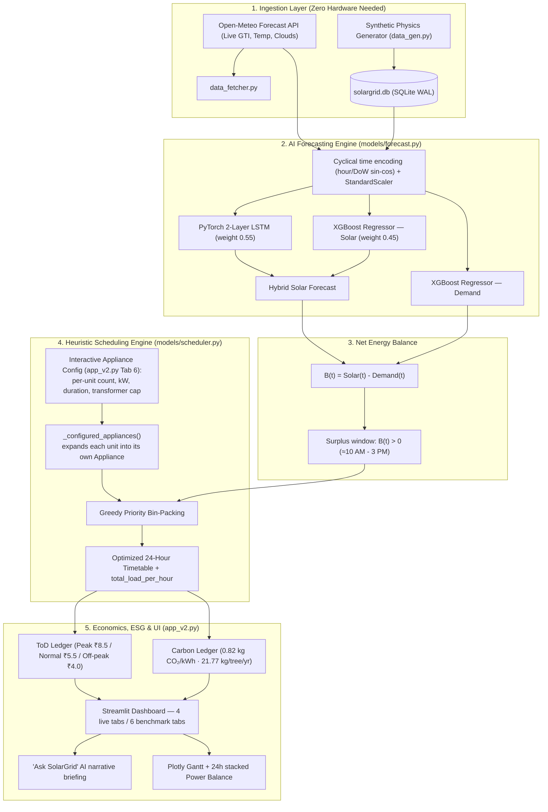

# ⚡ SolarGrid: AI-Enabled Solar Energy Forecasting & Smart Load Optimization

> **Candidate:** Suryansh Gupta · **Roll No:** 2023a1r116
> **Institution:** Department of Computer Science & Engineering, Model Institute of Engineering and Technology (Autonomous), Jammu, India
> **Status:** Full Production Implementation (Phases 1–7 complete, with interactive appliance controls & live-city mode)
> **Formal Documentation:** [Detailed Project Report (DPR.md)](DPR.md) · [Milestone Technical Report (PROJECT_MILESTONE_REPORT.txt)](PROJECT_MILESTONE_REPORT.txt)

---

## 📖 Newcomer's Guide: What is SolarGrid & Why Does It Matter?

If you are opening this repository for the first time, read this section before touching any code. It explains the *problem*, the *idea*, and *where each piece lives*.

### The Real-World Problem: The "Duck Curve" Dilemma
Imagine a residential society with a **50 kW** rooftop solar plant:

- **Midday (10:00 AM – 3:00 PM):** The sun is blazing and the panels produce up to **~48 kW** of free, clean energy. But most residents are away at offices and schools, so community demand is only **~12 kW**. The leftover **~36 kW of clean solar energy is wasted** or sold back to the grid for a tiny credit (just **₹2.50 per unit**).
- **Evening (6:30 PM – 10:30 PM):** Residents return home. Air conditioners, lights, TVs and kitchen appliances turn on. Demand surges to **30–45 kW**. With no sunlight, the community is forced to buy dirty, coal-fired grid power at expensive peak tariffs (up to **₹8.50 per unit**).
- **Uncoordinated heavy appliances:** Community equipment — EV charging stations (11 kW), water borewell pumps (5 kW), HVAC pre-cooling (3.5 kW) — is typically run in the morning or evening peak, inflating bills and straining the local distribution transformer.

```
Power (kW)
   ^
   |        Morning Peak (7-9 AM)                     Evening Peak (6-10 PM)
   |             /\                                          /\
   |            /  \       Midday Solar Surplus             /  \
   |           /    \      +--------------------+          /    \
   |   Base   /      \     | Solar: 25-50 kW    |         /      \
   |  Demand /        \....| Demand: 10-15 kW   |......../        \
   |  ------+              +--------------------+                  +-----
   +--------------------------------------------------------------------> Hour of Day
     00:00      07:00              12:00               19:00       23:00
                                 ▲
                    SolarGrid shifts heavy loads
                    (EVs, pumps, HVAC) right here!
```

### The SolarGrid Solution
**SolarGrid** is an intelligent microgrid energy-management system that:

1. **Predicts 24 hours ahead** how much solar power will be generated and how much the community will consume, using a **PyTorch LSTM + XGBoost hybrid ensemble**.
2. **Pulls real-world weather** from the free **Open-Meteo API** — live forecasts for any city (Jammu, Delhi, Mumbai, Bengaluru, Jaipur, Chennai) with **zero hardware sensor cost**.
3. **Automatically schedules** heavy, flexible appliances into the midday solar-surplus window using a **Greedy Priority Bin-Packing algorithm**.
4. **Lets you experiment interactively:** choose how many units of each appliance you own, set each unit's kW rating and run-duration, and set the transformer safety limit — every chart and every ₹/CO₂ number recomputes instantly.
5. **Protects the transformer** by never letting total hourly load exceed the configured safety cap (default **35 kW**, adjustable 20–60 kW).
6. **Quantifies the benefit** in Indian Rupees (₹) saved and **carbon footprint avoided** (kg CO₂) plus **equivalent mature trees planted**.

### Two Modes You Must Understand
The sidebar has a **Data Source** switch. This single choice changes what the dashboard shows:

| Mode | What it does | Tabs shown |
|:---|:---|:---|
| **🔬 Historical Benchmark** | Runs the ML models on a reproducible synthetic physics day (seeded by the calendar date). Uses the local SQLite dataset. | **6 tabs** — the 4 dynamic tabs **plus** 📊 Data Exploration and 🧠 Model Architecture & Evaluation. |
| **🌐 Live City Forecast** | Fetches *today's actual* hourly weather for the selected city from Open-Meteo and runs the same ML models on it. | **4 tabs** — only the weather-driven tabs. The dataset/model tabs are hidden because they describe the *training* data, which is not used in live mode. |

In **both** modes the four dynamic tabs (Forecast, Surplus, Carbon & Savings, Smart Scheduler) are fully live: change the city, the date, or any appliance control and **all** charts, KPIs and savings update.

---

## 🚀 2-Minute Quick Start

### 1. Prerequisites & Virtual Environment
Open a terminal in the project root (the folder containing `app.py`):

```bash
# Create and activate a virtual environment
python3 -m venv .venv
source .venv/bin/activate        # Windows: .venv\Scripts\activate

# Install dependencies (Streamlit, PyTorch CPU build, XGBoost, Plotly, ...)
pip install -r requirements.txt
```

> **Note:** `requirements.txt` pulls the **CPU-only** PyTorch wheel (`--extra-index-url https://download.pytorch.org/whl/cpu`) so installation is fast and works on cloud hosts without a GPU.

### 2. (Optional) Generate Data & Train Models
The repository ships with a pre-built `solargrid.db` and trained weights in `models/saved/`, so the app runs out of the box. To regenerate everything from scratch:

```bash
python data_gen.py            # writes 720 hourly rows (30 days) into solargrid.db
python models/train_models.py # trains LSTM + XGBoost, saves weights & metrics.json
```

If the models are missing, the app still runs using a **physics-based fallback** forecast (a warning banner tells you so).

### 3. Launch the Application
```bash
streamlit run app.py
```
Open **`http://localhost:8501`**. `app.py` is a tiny launcher that imports `organized_main()` from `app_v2.py` (the full production dashboard).

### 4. Run the Automated Test Suite
The scheduler is covered by **10 pytest cases**:

```bash
python -m pytest tests/test_scheduler.py -v
```

Expected: **`10 passed`** in well under a second. (If a third-party pytest plugin crashes on your machine, run with `PYTEST_DISABLE_PLUGIN_AUTOLOAD=1 python -m pytest tests/test_scheduler.py -v`.)

---

## 🏗️ System Architecture & Data Flow



**Key idea:** the *same* configured appliance list and transformer cap feed **both** the Carbon & Savings tab and the Smart Scheduler tab, so the two tabs can never disagree.

---

## 🧠 Core Engineering Concepts Explained

### 1. Why ensemble a PyTorch LSTM with XGBoost?
- **PyTorch stacked LSTM (weight 0.55):** recurrent networks have memory gates that capture smooth diurnal progression (a sunny morning tends to lead into a sunny noon).
- **XGBoost regressor (weight 0.45):** gradient-boosted trees excel at sharp, non-linear weather thresholds (cloud cover jumping from 20% to 85% causing an immediate solar drop).
- **The blend** (`models/forecast.py`): `solar = 0.55 × LSTM + 0.45 × XGBoost`. Demand is predicted by XGBoost alone (residential demand is more feature-driven than temporally autocorrelated).
- **LSTM architecture** (`models/lstm_model.py`): 8 input features → 2 stacked LSTM layers (64 hidden units, dropout 0.2) → take the **last** hidden state → dropout → a single `Linear(64 → 1)` regression head. Trained with **Adam (lr 1e-3)** and **Huber loss** (robust to outliers), gradient clipping, 30 epochs, best-validation-weight checkpointing.

> **Honest note on metrics:** the training script (`models/train_models.py`) evaluates on a chronological 80/20 holdout (144 unseen hours) and persists **MAE / RMSE / MAPE** to `models/saved/metrics.json`. Current stored values: **Solar MAE 1.338 kW, RMSE 3.133 kW, MAPE 9.14%**; **Demand MAE 0.913 kW, RMSE 2.214 kW, MAPE 6.41%**. The script does **not** currently compute an R² score or a formal LSTM-vs-XGBoost ablation table — those are listed as future work, not claimed results.

### 2. Real Data Without Hardware (`data_fetcher.py`)
Evaluators often push back on synthetic numbers. SolarGrid connects to the **Open-Meteo Forecast API** and pulls, for one full local calendar day (00:00–23:00):
- **Global Tilted Irradiance (GTI)** — radiation in W/m² hitting tilted panels (mapped to `solar_irradiance_wm2`).
- **Direct Normal Irradiance (DNI)** and **Cloud Cover (%)**.
- **Ambient 2-metre Temperature (°C)**.

It adds the same cyclical time features used in training and returns a 24-row DataFrame that drops straight into the inference pipeline. **No API key, no `requests` dependency** (stdlib `urllib`), 15 s timeout with 3 retries. If the network fails, the app gracefully falls back to the benchmark forecast and shows a warning banner — it never crashes.

### 3. The Greedy Priority Bin-Packing Scheduler (`models/scheduler.py`)
Rather than a heavy MILP solver (CBC/GLPK/Gurobi) that needs fragile native binaries, SolarGrid uses a deterministic heuristic that runs in milliseconds:

1. Compute hourly surplus `surplus[t] = solar[t] − demand[t]` and start `total_load[t] = demand[t]`.
2. Sort appliances by **priority** (1 = served first).
3. For each appliance, within its `[earliest_start, deadline_hour)` window:
   - **Non-interruptible (EV):** find the *continuous* block of `duration_hours` that maximises solar surplus while keeping every hour under the cap. If no fully-solar block exists, fall back to the **cheapest-tariff** block that still fits the cap.
   - **Interruptible (Pump, HVAC):** greedily pick the individual hours with the most remaining surplus, respecting the cap.
   - After assigning, reduce `surplus[t]` and raise `total_load[t]` so later appliances see the updated state.
4. Anything that cannot fit is reported in `unscheduled`.

**Transformer cap:** if adding a load would push `total_load[t]` above `peak_cap_kw`, that hour/block is skipped. **Off-peak fallback:** when solar is exhausted (e.g. monsoon), non-interruptible loads land in the cheapest night band (₹4.00/kWh) instead of expensive peak hours.

### 4. Interactive, Per-Unit Appliance Configuration (the newest feature)
The Smart Scheduler tab lets you model a *real* community instead of three fixed loads. Each appliance category is a bordered card with:

| Control | EV Charger 🔌 | Water Pump 💧 | HVAC Zone ❄️ |
|:---|:---:|:---:|:---:|
| Enable toggle | ✓ | ✓ | ✓ |
| **Number of units** | 1–5 | 1–4 | 1–3 |
| **Power per unit (kW)** | 3.0–22.0 (step 0.5) | 1.0–15.0 | 1.0–10.0 |
| **Run duration (h)** | 1–6 | 1–4 | 1–4 |
| Default rating | 11.0 kW / 3 h | 5.0 kW / 2 h | 3.5 kW / 2 h |
| Scheduling mode | one continuous block | splittable | splittable |
| Operating window | 06:00–17:00 | 06:00–18:00 | 09:00–16:00 |

Plus a **🛡️ Distribution Transformer Limit** slider (**20–60 kW**, default 35, step 1).

**How "number of units" works (Option B — individual instances):** if you set EV units = 2, the app creates **two separate appliances**, `EV Charger #1` and `EV Charger #2`, each scheduled independently. The scheduler can then place them in *different* surplus hours (interleaving) rather than treating them as one giant 22 kW block. This is done with `dataclasses.replace()` so the built-in `DEFAULT_APPLIANCES` are never mutated. A live caption under each card shows the maths, e.g. `2 × 11.0 kW = 22.0 kW · 3 h · by 17:00 · one block`.

Because the configuration is read from `st.session_state` (via `_appliance_settings()`), the **Carbon & Savings tab sees the exact same appliances** even though it renders *before* the Scheduler tab creates its widgets.

### 5. Carbon Footprint & "Trees Saved"
- **CEA India baseline:** the coal-heavy grid emits **0.82 kg CO₂ per kWh**. Every kWh of solar surplus consumed directly displaces one kWh of thermal generation.
- **Equivalent trees:** a mature broadleaf tree absorbs ~**21.77 kg CO₂ per year**. `compute_carbon_savings()` converts surplus kWh → kg CO₂ avoided → tree-equivalents, and projects annual figures (×365).

---

## 🖥️ Dashboard Tour

The four **dynamic** tabs always come first; the two **static** tabs appear only in Historical Benchmark mode.

| # | Tab | Mode | What you can inspect |
|:---:|:---|:---:|:---|
| 1 | **📈 24-Hour Forecast** | both | Interactive Plotly solar-generation vs demand curves with shaded surplus/deficit zones; hourly forecast table. |
| 2 | **⚖ Surplus Analysis** | both | Net energy balance `Solar − Demand` bar chart; exact surplus kWh and surplus-hour count. |
| 3 | **🌿 Carbon & Savings** | both | **"Ask SolarGrid" AI narrative box**, 4 carbon/tree KPI cards, 4 financial KPI cards (daily/monthly/annual ₹, grid energy avoided), and a ToD tariff cost breakdown. Reflects your appliance configuration. |
| 4 | **⚙️ Smart Scheduler** | both | **Interactive appliance configuration cards** + transformer-limit slider, transformer safety badge, surplus/grid/unscheduled metrics, **Plotly Gantt chart** (unmanaged vs AI-scheduled), 24 h stacked power-balance chart, hourly schedule detail table. |
| 5 | **📊 Data Exploration** | benchmark only | The 720-row historical dataset, temperature/cloud distributions, correlations, raw SQLite tables. |
| 6 | **🧠 Model Architecture & Evaluation** | benchmark only | LSTM layer parameters, XGBoost feature importances, holdout MAE/RMSE/MAPE from `metrics.json`. |

**Sidebar controls:** Data Source (Benchmark / Live), city selector (live mode), forecast date (today −30 … today +7), **Enable LSTM Ensemble** toggle (off = faster XGBoost-only), project info, and a model-status indicator.

---

## 📁 Codebase Directory Structure

```
suraj_nanga/
├── app.py                      # Entry point: imports organized_main() from app_v2
├── app_v2.py                   # Production dashboard (~1,547 lines, 4 live / 6 benchmark tabs)
├── app_interim.py              # Preserved Phase 1–4 interim dashboard (fallback only)
├── data_fetcher.py             # Open-Meteo REST client (live forecast + archive + city presets)
├── data_gen.py                 # Synthetic solar-geometry & dual-peak demand generator (720 rows)
├── solargrid.db                # SQLite database (WAL mode)
├── requirements.txt            # Dependencies (CPU torch wheel for fast cloud boot)
├── README.md                   # This onboarding guide
├── DPR.md                      # Detailed Project Report
├── PROJECT_MILESTONE_REPORT.txt# Academic milestone report
├── database/
│   ├── __init__.py
│   └── db_manager.py           # SQLite connection, WAL pragma & table schemas
├── models/
│   ├── __init__.py
│   ├── forecast.py             # Inference: 0.55/0.45 ensemble, live-weather support, fallback
│   ├── scheduler.py            # Greedy priority bin-packing + ToD + carbon accounting
│   ├── lstm_model.py           # SolarLSTM (2×64, dropout 0.2, Linear(64→1) head)
│   ├── train_models.py         # Offline training & holdout evaluation (writes metrics.json)
│   └── saved/                  # lstm_solar.pt, xgb_*.json/.joblib, scalers, metrics.json
└── tests/
    ├── __init__.py
    └── test_scheduler.py       # 10-case pytest suite
```

---

## 🛠️ Developer & Customization Guide

### Add a new city
Append coordinates to `CITY_PRESETS` in `data_fetcher.py`:
```python
CITY_PRESETS["Kolkata"] = {"lat": 22.5726, "lon": 88.3639}
```
It immediately appears in the live-mode sidebar dropdown.

### Add a new appliance category (two places must agree)
1. **Model side** — add an `Appliance` to `DEFAULT_APPLIANCES` in `models/scheduler.py`:
   ```python
   Appliance(
       name="Community Laundry",
       power_kw=4.0, duration_hours=2, priority=4,
       interruptible=True, deadline_hour=16, earliest_start=8,
   )
   ```
2. **UI side** — add a matching entry to `_APPLIANCE_UI` in `app_v2.py` (same order as `DEFAULT_APPLIANCES`), giving the slider ranges and unit label:
   ```python
   {"key": "laundry", "icon": "🧺", "unit_label": "Laundry Unit",
    "kw_min": 1.0, "kw_max": 8.0, "count_max": 3, "dur_max": 4},
   ```
The configuration helpers zip these two lists together, so they must stay aligned. Priority, interruptibility and the time window always come from the dataclass; the UI only overrides count, kW and duration.

### Retrain the models
```bash
python models/train_models.py
```
Retrains the LSTM and both XGBoost regressors, recomputes holdout MAE/RMSE/MAPE, and refreshes `models/saved/` (weights, scalers, `metrics.json`, `feature_cols.json`).

### Run the scheduler standalone (no UI)
```bash
python -m models.scheduler
```
Prints a sample schedule, ToD savings and carbon savings for a synthetic noon-peaking day.

---

## 🎓 Academic Defense / Viva Voce Cheatsheet

1. **Why an ensemble instead of a single model?**
   Solar has both smooth diurnal progression and abrupt cloud-induced step drops. The LSTM keeps sequential temporal context; XGBoost handles non-linear cloud/temperature thresholds. Blending `0.55·LSTM + 0.45·XGB` combines both strengths. (Holdout MAE/RMSE/MAPE are in `metrics.json`; a formal ablation is future work.)

2. **How is this "real data" without physical sensors?**
   The Open-Meteo Forecast API streams satellite/NWP-derived GTI, DNI, cloud cover and temperature. "Live City Forecast" runs the models on the actual atmospheric conditions for the chosen city and day.

3. **How does the scheduler protect the grid?**
   A hard cap (`peak_cap_kw`, default 35 kW, UI-adjustable 20–60) on `base demand + scheduled appliances` per hour. Slots that would breach it are skipped; the safety badge reports any overload and even flags when base demand alone exceeds the limit.

4. **What happens on a fully overcast monsoon day?**
   Surplus `B(t) ≤ 0` everywhere. Non-interruptible loads fall back to the cheapest-tariff block (night off-peak ₹4.00/kWh) instead of expensive peak hours; `test_zero_solar_all_grid` verifies surplus used is 0.

5. **What does "number of units = 2" actually do?**
   It creates two independent `Appliance` instances (`EV Charger #1`, `#2`) via `dataclasses.replace`, each scheduled separately so they can interleave into different surplus hours. `compute_tod_savings` is passed the same instance list so renamed units are costed correctly (this was a real bug that previously zeroed the savings).

6. **Why is the carbon factor 0.82?**
   It is the CEA (Government of India) weighted-average grid emission factor, reflecting India's coal-heavy generation mix.

---

## 🧯 Troubleshooting & Known Behaviour

- **"⚠️ Live weather fetch failed — showing benchmark synthetic forecast instead."** The Open-Meteo call failed (offline, timeout, or an incomplete day). The app falls back by design; check your connection and retry. Failed fetches are *not* cached.
- **"⚠️ ML models not found."** Run `python data_gen.py` then `python models/train_models.py`. Until then a physics fallback keeps the UI alive.
- **SSL certificate errors on macOS** when fetching live data: point Python at certifi, e.g. `export SSL_CERT_FILE=$(python -c "import certifi; print(certifi.where())")`.
- **Active tab jumps back to "24-Hour Forecast" after changing a widget.** This is a pre-existing Streamlit behaviour in this app (present before the interactive-controls work). Your settings are preserved — just click back to the tab you were on. It does not affect correctness of any calculation.
- **A pytest plugin crashes on import:** run with `PYTEST_DISABLE_PLUGIN_AUTOLOAD=1`.

---

## 📜 License & Acknowledgments

Developed by **Suryansh Gupta** (Roll No: 2023a1r116), **Department of Computer Science and Engineering, Model Institute of Engineering and Technology (MIET Autonomous), Jammu**.
Built with Python, Streamlit, PyTorch, XGBoost, scikit-learn, Plotly, SQLite, and the Open-Meteo API.